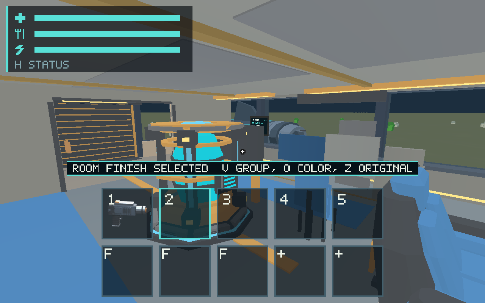
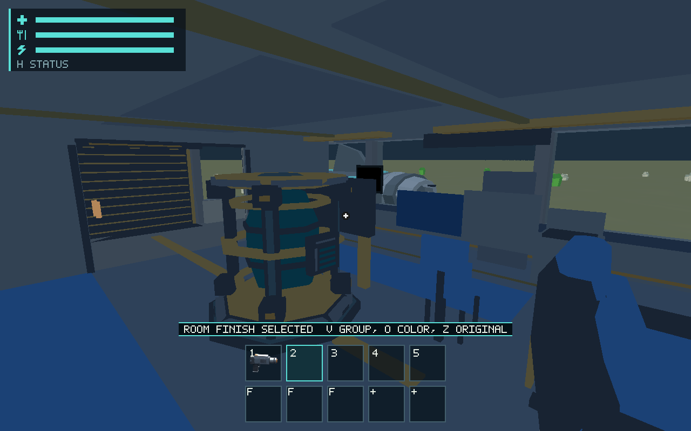
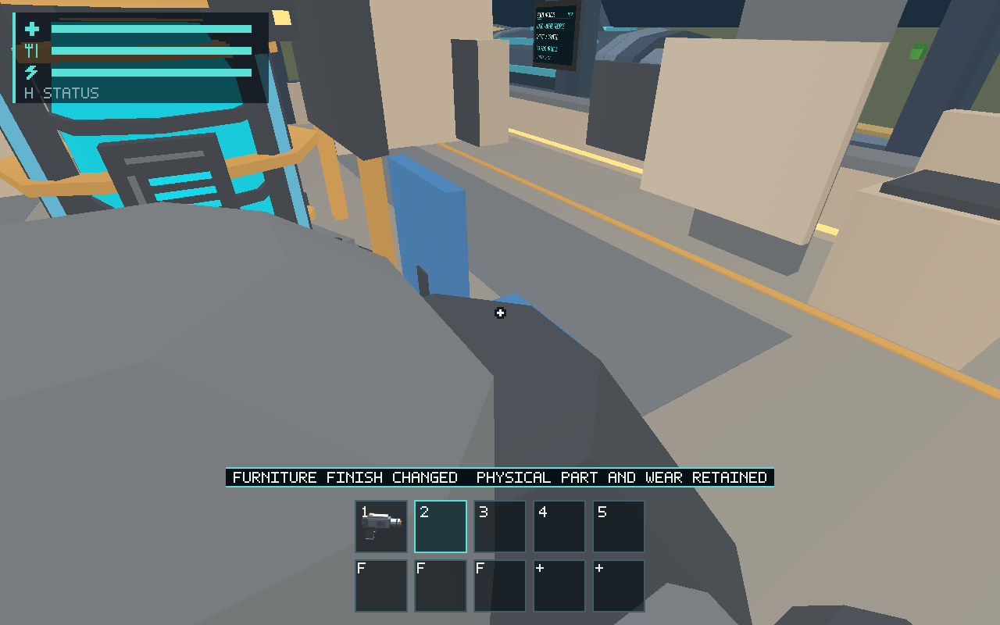

# #579 persistent room groups and furniture finishes

Implements five independent room color groups and exact furniture overrides using
bounded curated Original/Slate/Ochre factors. Nearby physical galley/cargo-door
controls use V/O/Z; O/Z on bunk, seat, table or locker controls that item. Cosmetic
changes remain free/instant, preserve physical material/age/damage authority and
never recolor functional indicators. See [the maintained contract](../../docs/room-finishes.md).

## Checks and evidence

Host: macOS 26.2, Apple M1, Rust 1.89. Final native captures use production wgpu,
1280×800 drawable surfaces and actual protocol key admission after explicitly
seeded camera positions. Named reference cameras are diagnostic presentation,
not proof of a walked route or physical pointer/device qualification.

- `cargo test --workspace --locked`: pass (383 runtime, 98 ship, 80 renderer, 73 character; existing ignored lanes retained).
- `cargo clippy --workspace --all-targets --locked -- -D warnings`, `cargo fmt --all -- --check`, `git diff --check` and `python3 scripts/check_docs.py`: pass.
- Production controls/source/save tests preserve physical source and reject unknown furniture atomically. A structural integration test creates two room records, removes the shared wall, and roundtrips separate finish histories.
- `python3 scripts/salimon-test run scenarios/evidence/room-finishes.json --binary target/debug/salimon-client --artifacts artifacts/579/room-final --screenshot-command '["native"]' --summary`: 27/27 pass.
- Same runner for `room-finishes-blackout.json`: 27/27 pass; `furniture-finish.json`: 13/13 pass. Exact commands/results are in [results](native/results.json), [original protocol](native/protocol.zip), and [validation logs](validation.zip).

Native [resource counters](native/resources.json) report 6,771 ship triangles,
1,625,040 resident vertex bytes, one 352-byte uniform and two ship draws. Fixture
view reports 268 triangles, 18,128 resident geometry bytes, 1,136 instance-capacity
bytes and ten batches. Recoloring adds no geometry, textures or per-style materials;
ship group tags add four bytes per existing vertex and palette uniforms add 160
bytes. Original CPU/GPU timestamps and background stalls are retained; these
captures are not a hardware budget qualification. Missing allocator counters
remain unavailable.

Initial renderer tests caught the Archive terminal still writing 19-float vertices
into the new 20-float layout. Corrected both producer and consumers, reran the full
suite and recaptured final evidence. Earlier output is retained as pre-fix evidence,
not counted as acceptance.

## Documentation impact and remaining owners

Updated ship/runtime/renderer/persistence owning guides, save schema 13, renderer
buffer contracts, root routing, user controls, scenario/reference instructions and
[room finish contract](../../docs/room-finishes.md). Local links and same-PR impact
are checked. Source/tests map to `ship/finishes.rs`, `structure/tests.rs`, runtime
`session/finishes.rs` and the renderer surface allowlist.

Physical new-room installation/removal remains #545; placeholders do not create
rooms. Its eventual integration must pass real room/part identities to this registry
and renderer. The current structural/source regression establishes history retention,
not a playable construction tour. Actual damage/component ageing remain with #549
and their visual owners; recoloring touches no such source. No aged-state screenshot
is fabricated where that source is not implemented. Human material/appearance
acceptance remains #561 and hardware budgets #563.
