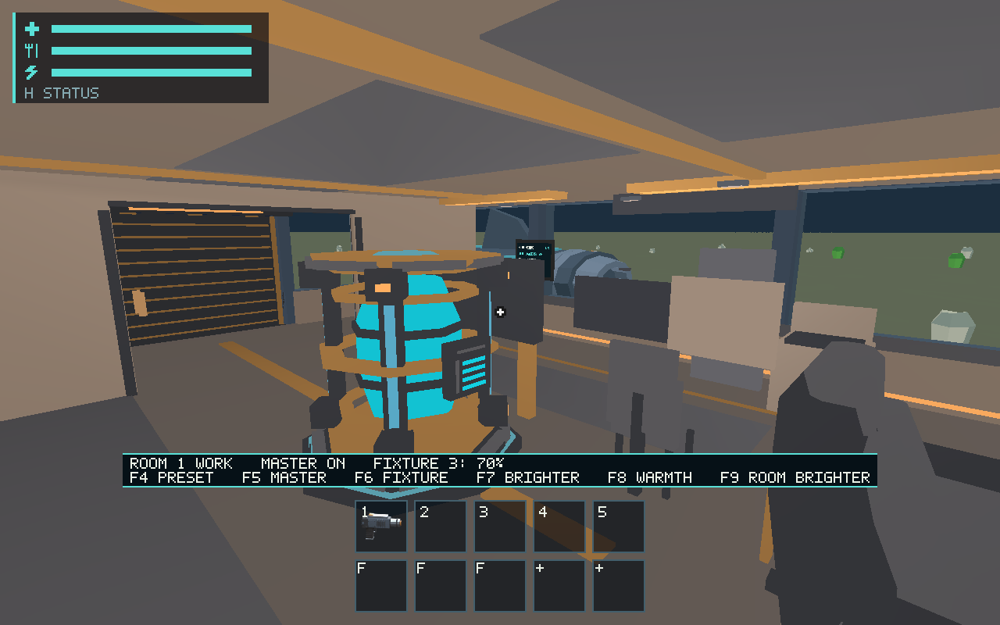
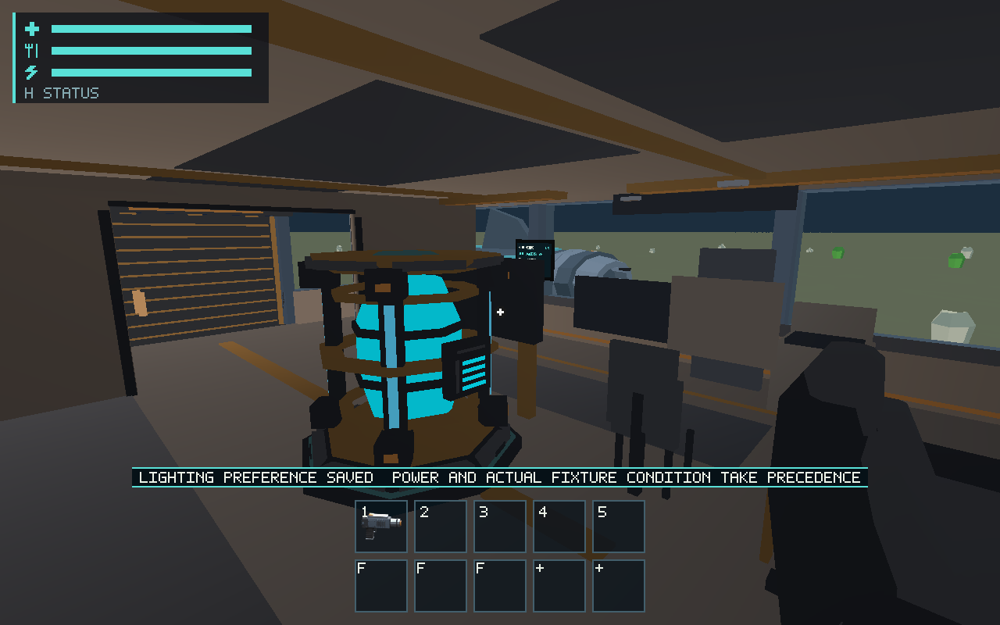
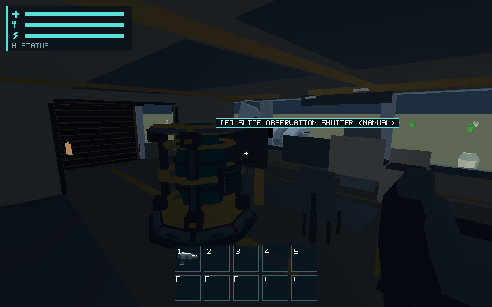
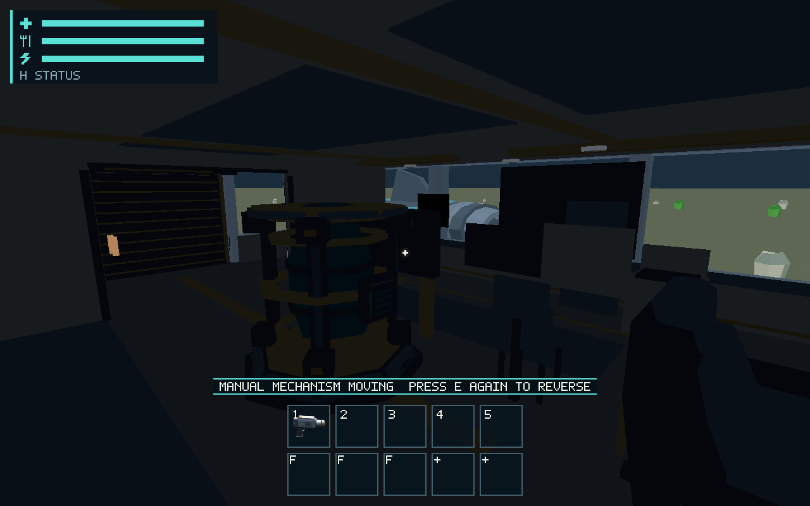

# #580 room and fixture lighting

Delivers durable per-room presets, master controls, general brightness/warmth,
five independent fixture overrides and physical lamp operability. Actual Core
power/condition suppress output without resetting preferences; machine screens
and status emission remain independently authoritative. Hull and independent
fixture meshes share effective light. Sun direction, planetary occlusion and
actual shutter travel drive localized window illumination during blackout.
See [the maintained contract and controls](../../docs/room-lighting.md).

## Validation and original evidence

- Focused runtime/ship/renderer lighting tests passed: physical control admission,
  preferences/energy/mass restoration, actual open/closed window contribution,
  broken/power/master precedence, independent room history, malformed values and
  local falloff/isolation.
- `cargo test --workspace --locked`: passed, including the final #543 transaction regressions.
- Workspace all-target Clippy, formatting, documentation and diff checks passed.
- Production native-wgpu routes: presets/overrides/master/1920×1080 26/26;
  powered shutter open/closed/reopened 12/12; blackout shutter 12/12;
  broken fixture 2/2; dark-space blackout 2/2.

[Full source/state/protocol and logs](native/protocol.zip),
[per-capture environment, settings, resource and timing observations](native/metrics.json).
Xvfb/Linux, llvmpipe LLVM 19.1.7 software Vulkan; named reference camera, protocol
inputs, 16 ms simulation steps. Default captures are 1280×800; the full-HD capture
is 1920×1080. These are original wgpu images, not CPU fixtures or authoring previews.

## Resources and limits

Native views retain two ship draws, 1,625,040 resident ship vertex bytes,
6,771 ship triangles, 576 uniform bytes, and ten visible fixture batches with
18,128 resident geometry bytes, 1,600 instance capacity bytes and 268 visible
fixture triangles. Lighting adds 224 ship-uniform bytes, 16 bytes per fixture
instance and ten small existing-pass housing/diffuser cuboids; no new GLB/material
or per-frame geometry generation. Source/history remains bounded to 64 rooms.
Raw GPU/CPU distributions, allocation and capture stalls are retained in metrics.
The screenshot route includes 1–1.5 s capture stalls; it is not a clean performance
benchmark or evidence of hardware FPS. No threshold is loosened or approved.

The initial native attempt found a stale Xvfb socket; the retained successful
runs use a dedicated live display. The first shutter scenario stopped at 70 of
75 required 16 ms ticks; final 80-tick runs reach both actual endpoints. The
initial dark-space setup needed inclusion in the E2E flying-state assertion;
that host-only scenario classification is corrected. No physics rule changed.

Dark surfaces retain a small readability floor, not emergency electricity.
Window lighting is stylized finite falloff with conservative sphere occlusion,
not full shadows/GI/PBR. Fixture condition is an actual persisted source input;
future damage events remain #549. New constructed rooms remain #545; their
settings can retain independent IDs without forced merging. No lamp wattage is
invented. Schema 16 migrates historical defaults and rejects incompatible custom
historical state/missing installed rooms. Human image/readability approval #561,
physical platform #557 and actual hardware budgets #563 remain separate.
