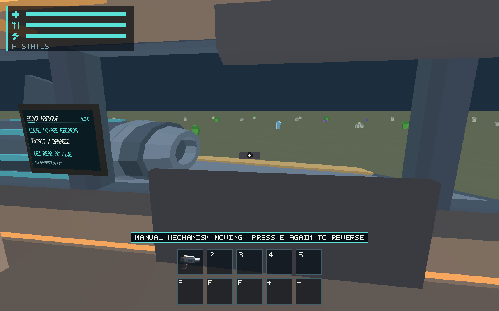
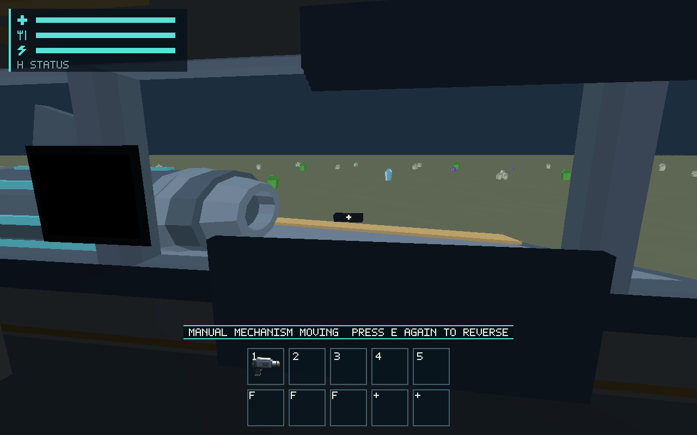

# #583 tactile fixture sounds and physical acoustic boundaries

Implements real bunk/table/seat/screen/shutter/locker/cargo-door travel, release,
reversal and endpoint cues; actual mount/clamp/harness changes; different cargo
and habitation foot contact. Physical cargo-door and finite privacy-screen
geometry attenuate/filter sources while retaining distance and stereo direction.
The continuous CPAL callback has bounded original mechanical/noise synthesis and
rate-calibrated filtering. No pressure simulation, random creaks, music or gameplay
authority is introduced. [Canonical ownership/contract](../../docs/scout-acoustics.md).

## Validation

- Full locked workspace suite passed: 400 runtime, 102 ship, 81 renderer, other
  domain suites; existing ignored lanes retained. Final focused source mapping
  (15 passed), callback continuity/headroom (3 passed) and actual mount transaction
  tests (4 passed) also pass after coefficient preparation moved out of the sample
  loop. The source tests cover blocked unchanged travel, all seven mechanisms,
  reversal/endpoints, blackout, same-clock restore, multiple partitions, finite
  apertures, panning, stale/reset/mute and rejected mount inputs.
- Workspace all-target Clippy, fmt, diff and documentation checks passed;
  Python runner tests: 21 passed.
- Four final production-wgpu E2E routes, powered shutter, blackout shutter,
  locker and table: 17/17 each. They verify actual travel, reversal, endpoint
  events and stopped gains. [Original protocol/images](native/protocol.zip) and
  [state/filter/event/resource observations](native/observations.json).
- `SALIMON_AUDIO_EVIDENCE=artifacts/583/audio-final-complete cargo test -p salimon-client --locked tactile_audio_evidence_583 -- --ignored --nocapture`: passed;
  identical regenerated waveform bytes are asserted for production control sequences.
- `ALSA_CONFIG_PATH=artifacts/583/native/alsa.conf SALIMON_AUDIO_EVIDENCE=artifacts/583/native cargo test -p salimon-client --locked tactile_native_output_583 -- --ignored --nocapture`: passed with actual CPAL callbacks and captured virtual sink output.

E2E stays intentionally silent: its `preview_only:true` event/gain/filter mapping
is observational evidence, not device playback. The initial native assertions
correctly found this existing suppression; final captures expose the same mapping
without enabling E2E device playback. Native images are Linux/Xvfb/Mesa llvmpipe
software Vulkan, 1280×800, protocol input and 16 ms steps, not physical latency.

## Original audio and measured limits

- Production mechanism control sequences: [table](audio/table.wav),
  [locker](audio/locker.wav), [bunk](audio/bunk.wav),
  [shutter](audio/shutter.wav), [manual blackout shutter](audio/shutter-blackout.wav).
  Per-tick fractions/events/epochs are beside each WAV.
- Same-source partition comparison: [cargo open](audio/cargo-door-open.wav) /
  [closed](audio/cargo-door-closed.wav), [privacy open](audio/privacy-open.wav) /
  [closed](audio/privacy-closed.wav). Closed cargo gain is exactly 0.22 of open;
  screen 0.72; coefficients 0.08/0.4. These are authored stylized values.
- Isolated synthetic callback timbres for seat, privacy screen, cargo door,
  mount clamp, restraints and both floor contacts are named `*-timbre.wav`.
  They are listening references, not claimed walked routes.
- [Actual CPAL virtual-sink recording](audio/actual-cpal-output.wav),
  [lossless original float32 little-endian PCM](audio/actual-cpal-output-f32le.raw.gz),
  [actual device/callback metadata](audio/actual-output.json),
  [explicit ALSA sink configuration](audio/alsa.conf).

[PCM metrics](audio/metrics.json) retain debug CPU/peak/size measurements.
The final simultaneous 27-slot stress waveform peaks at 0.300106 and takes
326.02 ms CPU for 138,240 frames (2.88 s at 48 kHz), including fixture copies.
Table/shutter production sequences take 336.09/329.41 ms for 2.896 s, with peaks
0.01482/0.02619. This shared debug cloud run is not an approved CPU/hardware budget.
Callback state is fixed: 2,736-byte mixer and 568-byte mailbox; no callback
allocation, locks or logging. Runtime caps scene voices at 24 and pending events
at 12, prioritizing alerts and coalescing/dropping dense incidental events.

The ALSA file/null sink is virtual and unpaced. It reports one-frame callbacks,
1,043 deadline overruns and 206,232 active frames in the retained run; those are
not hidden or called a hardware timing pass. The F32/stereo/48 kHz original and
PCM16 listening copy establish the actual configured output path, not speaker,
microphone, real-time latency or device-switch qualification. Human timbre/stereo
and comfort review remains #561, actual devices #557, budgets #563.

Mount sound journals all supported attachment transactions; no first-eight-object
truncation remains. Only accepted source changes emit contact. Save/restore uses
an excluded audio epoch and never replays a saved latch, changes mass/joules or
advances source state. Generic multiple-boundary tests support later rooms;
actual constructed room registration stays #545. Baseline promotion and human
listening approval are not implied by this delivery.

## Final approved stack verification

After the owner approved the construction catalog and all branches were rebased,
`cargo test --workspace --locked` passed on the complete approved stack. Final
all-target Clippy, fmt, docs and diff checks also passed; workspace is clean.
[Full final test log](salimon-approved-stack-tests.log.gz),
[Clippy log](salimon-approved-stack-clippy.log.gz),
[documentation log](salimon-approved-stack-docs.log.gz).
