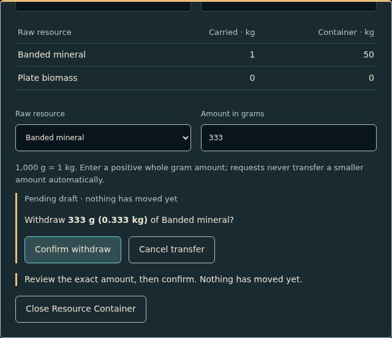

# Issue #829 — Resource Container industrial equipment dialog

The existing Resource Container now uses a reusable `EquipmentDialog` composed
from the shared native Dialog, Button, Progress and Expedition Interface tokens.
The shell provides identity/title/status, machine content, feedback and actions.
Paired carried/container instruments compare kg, exact g and free capacity;
player slots, the raw table and exact positive whole-gram input remain explicit.
Draft review, committed success and rejection/save blocking have distinct wording.
The transfer controller, authoritative session/ledger, save schema and world
renderer are unchanged. No Core/Fabricator/equipment mechanics were introduced.

## Revisions and environment

- Branch `issue-829-industrial-container`, base `main` at
  `db21e8861accfc3f8b73768201508b77ba91476c`. No active PR stack existed.
- Tested source commit `6a6de074e2b88412d4615c3a57263b68e644aaa1`;
  its `client` tree is `b5876463154ac960025af89fb4b6f37f2e2b59ef`.
  Subsequent report/evidence-only commits reuse these unchanged inputs.
  Final head/base binding is recorded on the PR.
- Docs PR #825 and shared primitives #826 are merged and present in this base.
  Issue #829 has no formal blocked-by entries; its textual prerequisites were
  checked against source. The issue stays open until merge.
- Debian 13, Linux x86_64; preinstalled Node 24.19.0, npm 11.9.0,
  system Chromium 154.0.8037.57 (`CHROMIUM_PATH=/usr/bin/chromium`).
  Locked project setup: `cd client && npm ci --no-audit --no-fund`.
  Playwright 1.64.1, TypeScript 5.9.3, Vite 7.3.7, React 19.3.1.
- Production overhead SVG/CPU raster path; cockpit regressions use the existing
  ANGLE SwiftShader flags. Headless synthetic Playwright keyboard/pointer input,
  DPR 1, en-US, UTC, fixed journey clock 2026-11-04. No hardware GPU/FPS claim.

## Criterion/check matrix

All commands run from `client` unless otherwise noted. Checks use the production
built entry for storage, plus domain/session tests for unreachable catalog states.

| Issue criterion / category | Procedure | Result / evidence |
| --- | --- | --- |
| 1, 2, 3 / unit and integration | `npm test`: ledger, inventory, session, container controller tests; exact/invalid IDs/grams, source/weight/slots, stale/quota/external save rejection, interruption preserving prior commits | PASS, 158 tests; [log](logs/unit.log) |
| 1–5 / typecheck/build | `npm run build` | PASS; [log](logs/build.log); existing Vite large-chunk warning |
| 1, 2, 3 / production E2E | `CHROMIUM_PATH=/usr/bin/chromium npm run test:browser`, STORE-UI-1/2: mine → enter → deposit 333 g → withdraw 111 g → cancel/Escape/blur → exit → reload, twice; reconcile source + player + store; reject invalid/full/overweight/external-save cases | PASS all five storage tests in full run; [full-run log](logs/browser-system-chromium.log), [81-test results](logs/browser-system-summary.json), [raw journey state](captures/storage-journeys.json) |
| 4, 5 / visual and accessibility | STORE-UI-3 at 960×600, 1280×720, 1920×1080: named modal/input descriptions, keyboard wrap/isolation, 2 px focus, accessible live feedback, token text contrast, bounded dialog/local scroll/no body overflow, normal/reduced-motion entry, exact state labels and repeated original captures | PASS focused 3/3; [log](logs/layout.log), [captures and measurements](captures/) |
| 5 / reuse and source review | Shared typed EquipmentDialog slots reuse native Dialog lifecycle/keyboard isolation; only container content owns transactions | PASS source review; future machines remain absent |
| All / CI regressions | Existing Navigation client workflow, including navigation/visual negative scripts and repeat campaign | UNVERIFIED — CI awaiting user report; no status queries or monitoring |
| Manual/hardware qualification | Physical keyboard/assistive-technology audio, Metal/device performance and subjective visual taste | NOT RUN, separate device/owner qualification; automated accessibility checks cover browser semantics, not actual screen-reader speech |

The production catalog cannot fill all 12 slots with count-items: slot rejection
uses the existing domain test's validated synthetic shared inventory usage.
Movement/range/target/scene/seat interruption and quota failures use production
controller/session tests; built browser tests exercise Escape/blur and external
save failure. No mocked UI transfer authority substitutes for the live journey.

## Original visual evidence

`captures/measurements-{960,1280,1920}.json` records viewport, bounds, scroll,
contrast and SHA-256 of each original. `industrial-{width}-{ready,pending,
committed,rejected}.png` captures the native panel at actual viewport bounds;
`*-controls.png` retains the lower scroll position where needed. Every industrial state
capture is byte-identical on repeat. Ready and pending checkpoints are required
to differ; STORE-UI-1 also compares a wrong checkpoint with the existing image
comparison policy and requires rejection. Existing navigation references and
thresholds are unchanged.

Minimum measured text contrast over opaque panel: **5.37:1** (danger);
principal text **11.28:1**, muted labels **7.96:1**. The opaque capacity/field
surface is darker. At 960×600 the 640 px-wide panel stays within a 552 px-high
scroll region; controls and feedback remain keyboard reachable inside it.
At 1920×1080 the idle panel fits without scrolling. The shared 180 ms entry fade
is interruptible by dismissal; reduced motion sets its duration to zero.

The full-world `storage-{open,transferred,error}-0.png`, `storage-full.png` and
`storage-save-error.png` retain production originals, indexed by
[journey hashes](captures/journey-hashes.json). The [raw journey state](captures/storage-journeys.json)
retains exact before/after save envelopes, simulation observations and the wrong
checkpoint comparison. Focused and full tests used unchanged source inputs.

## Iteration failures and fixes

- Initial focused run: 3 passed, 2 failed. The new test incorrectly sent unequal
  checkpoint dimensions to the comparison helper, and a repeat exposed a blinking
  caret. Source/capture inspection also found the legacy global 520 px dialog
  maximum. The equipment shell now overrides that maximum and heading ink;
  negative checkpoints allow a real geometry difference rather than forcing
  equal dimensions. [Initial log](logs/iteration-storage.log).
- Second focused run: 4 passed, 1 failed. Exactly 28 changed pixels in the
  1920-width repeat were localized to the focused native input caret. Original
  [first](failures/caret-original.png) and [repeat](failures/caret-repeat.png)
  and [log](logs/iteration-caret.log) are retained. Captures now focus the dialog
  after separate explicit input-focus checks and advance the controlled clock
  to settle interaction styles. No image mask or tolerance change was introduced.
- Corrected focused matrix: 3/3 PASS.
- Full browser run with preinstalled Chromium 154: **79 PASS, 2 FAIL** in 21.6
  minutes. Both failures are strict environment guards for the navigation and
  panoramic baseline suites: expected Chromium **156.0.8078.4**, actual
  **154.0.8037.57**. No pixel assertion or functional test failed. The complete
  [log](logs/browser-system-chromium.log) and [test results](logs/browser-system-summary.json)
  preserve these failures. Installing the matching locked Playwright browser and
  rerunning only these two suites resolves this environment mismatch without
  changing source, references or thresholds; **2/2 PASS** on Chromium 156.0.8078.4 (3.2 minutes):
  `env -u CHROMIUM_PATH SALIMON_EVIDENCE_DIR=test-results/visual-matching-browser npm run test:browser -- --project=navigation-captures`.
  See [successful log](logs/visual-matching.log), [navigation comparison](logs/navigation-comparison.json)
  and [panoramic comparison](logs/panoramic-comparison.json). These are a focused
  rerun at the same source commit, not a second complete browser campaign.
  Aggregate local coverage: all 81 browser tests pass across the original
  system-browser run and this matching-browser rerun; the original full command's
  two environment failures remain recorded.

## Documentation impact and same-session review

Updated [client usage/API](../../client/README.md#resource-container-transfers-785),
[resource invariants](../../docs/resource-inventory-and-gathering.md#industrial-equipment-presentation-829),
[presentation contract](../../docs/hud-ui-style-guide.md#resource-container-equipment-implementation-829)
and [owner routing](../../docs/maintenance-map.md). The production panel/CSS map
to container presentation, shared primitives to modal lifecycle/presentation,
and `tests/storage.spec.ts` to production E2E/visual verification.
No new gameplay authority or save contract requires architecture/schema changes.
Changed-guide local files and cross-guide anchors resolve ([link check](logs/links.json));
`git diff --check` passes.

Reviewer: implementing Codex agent in this same active chat, not independent
execution. Reviewed source diff, issue criteria, raw measurements, original
pending/control/rejected captures and actual local results. Local review is
**QA pending; final ACCEPT awaits user-reported current-head CI**. There are no
known unresolved local implementation findings. Current repository policy
(PR #834) leaves deployed visual review with the owner and has removed the
manual baseline-approval CI job; this change does not reinstate that gate.

Environment additions: matching Playwright **Chromium 156.0.8078.4** and
**Chrome Headless Shell 156.0.8078.4**, revision **1248**, plus Playwright
**FFmpeg revision 1013** (installer-managed). Reproduce on Linux x86_64 after
project `npm ci`: `cd client && npx playwright install chromium`. Downloads use
the default `/home/agent/.cache/ms-playwright` cache; unset `CHROMIUM_PATH` to
select this matching browser. See [successful install log](logs/browser-install.log).
These browser prerequisites can be added to the reusable template setup; locked
npm dependencies remain project setup. Node/npm and system Chromium 154 were
preinstalled. No system packages or runtime upgrades were installed, and the
saved environment template was not changed.
